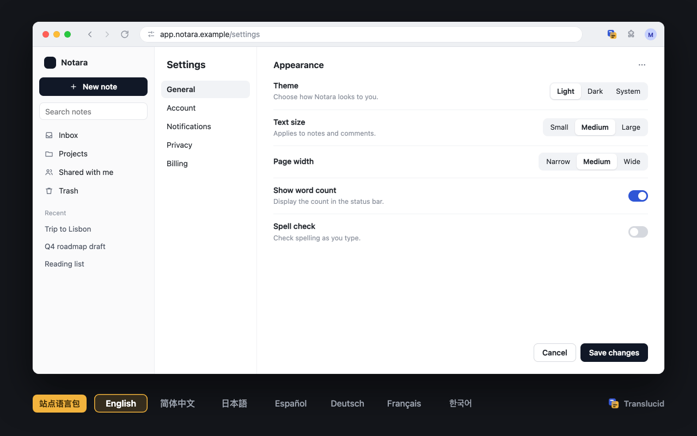
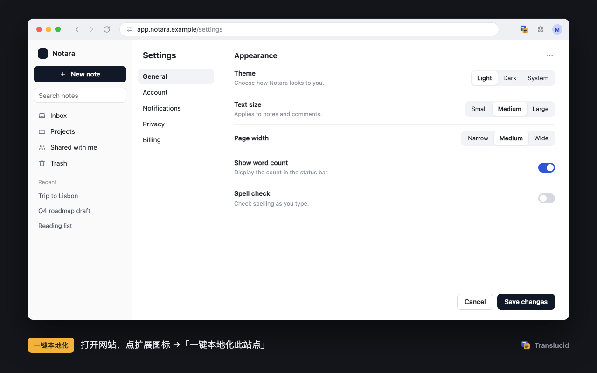
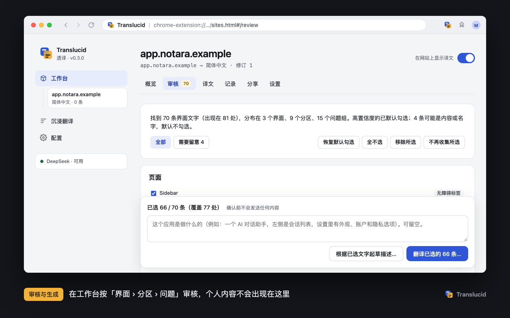
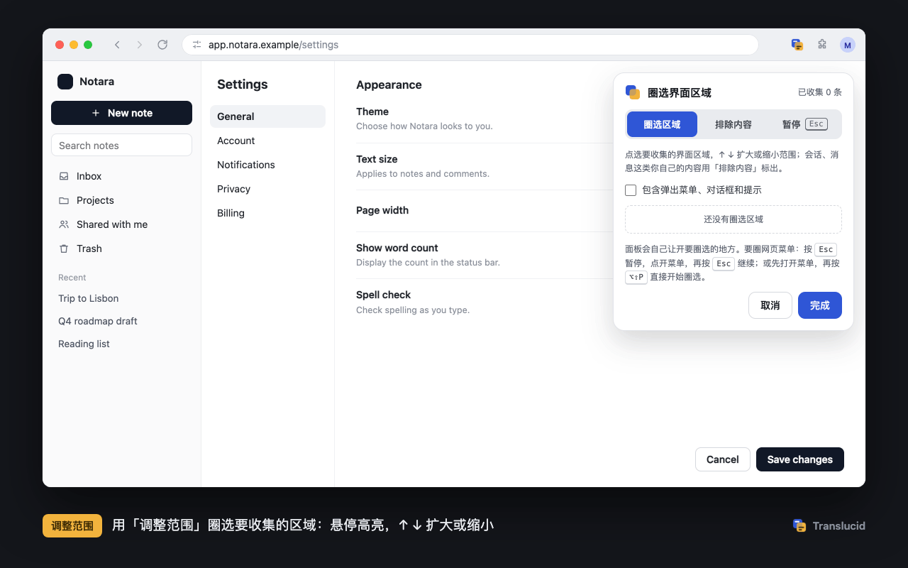
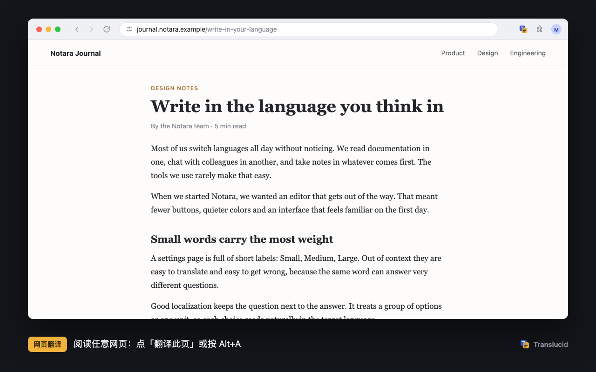

# Translucid · 透译

[简体中文](README.md) · English

Translucid builds local **site language packs** that show a web app's interface in **any** language, and translates web pages into **Simplified Chinese** with an LLM (side by side or translation only). It is a Chrome / Edge extension (Manifest V3). You bring your own API key; there is no server and no telemetry.

> The extension's own interface is in Simplified Chinese. Below, its labels are given in Chinese with an English translation, such as 一键本地化此站点 (Localize this site).

<p align="center">
  
</p>
<p align="center"><sub>One web app, its interface in seven languages. The note titles under 最近 (Recent) in the sidebar are your own content and always stay as written.</sub></p>

The extension has three parts, opened from its side navigation or the toolbar icon:

| | What it does |
|---|---|
| **工作台** (Workbench) | Site localization, the headline feature: scan a site's interface, review, then generate and manage a language pack for each site |
| **沉浸翻译** (Immersive translation) | AI translation while you read any web page: display styles, domain experts, glossaries, site rules |
| **配置** (Config) | Providers and routing, usage and cache, about and privacy |

---

## Site localization

Generate a complete interface translation for the web apps you use every day, such as an AI assistant or a developer tool that has no interface in your language.

- **Scan.** The scan opens menus, settings sections and dropdowns by itself to find the interface text.
- **Translate by structure.** Strings go to the model in groups that follow screen › section › question › option. The same word can therefore get a different, correct translation under each question it answers, for example "Medium" under Text size and "Medium" under Page width.
- **Reuse.** The result is stored on your device. From then on the site opens in your language without further model requests.

<p align="center">
  
</p>
<p align="center"><sub>One-click scan: it opens settings sections and menus and collects the interface text. It changes no settings and restores the page when it is done.</sub></p>

1. Open the site you want to localize. To translate its settings too, open its settings window first.
2. Click the extension icon, pick the target language in the 本地化 (Localize) tab, and click 一键本地化此站点 (Localize this site).
   - Before the first scan of a site, the extension explains what the scan will do and asks for your consent.
   - The scan only opens navigation and menus, changes no settings, and restores the page when it is done.
   - Press Esc to stop it at any time.
3. Review what was found in the 工作台 (Workbench):
   - Strings are grouped by interface structure, and high-confidence ones are already ticked.
   - Strings that might be content or names are unticked, with the reason shown.
   - Personal content such as chat lists, messages and account names is never collected.
4. Confirm once. You see the exact request first, then click 确认发送并生成 (Confirm, send and generate).
5. Open pages show the translation right away.
   - New interface text met during everyday use is kept for you to review. You can turn this off.
   - At any time you can show the original, edit translations by place, and export or import the pack.

<p align="center">
  
</p>
<p align="center"><sub>Review and generate: options are translated together with the question they answer. The same "Medium" becomes 中 under Text size and 适中 under Page width.</sub></p>

**Manual scope.** For precise control, use 调整范围 (Adjust scope) to mark regions to collect or to leave out.

- When the pointer rests on something the panel covers, the panel moves out of the way. It stays put when you head for its buttons.
- There are two ways to pick inside a page menu that is open:
  - Open the menu first, then press `Alt+Shift+P` to start picking. Clicking the extension icon would take focus from the page and close the menu.
  - Or press `Esc` while picking to pause, open the menu as usual, and press `Esc` again to continue.

<p align="center">
  
</p>
<p align="center"><sub>Adjust scope: hover to highlight, ↑ / ↓ to widen or narrow, click to mark an interface region. Mark your own content with 排除内容 (Exclude content).</sub></p>

Recognized interface structures:

- section navigation in settings dialogs;
- labelled option groups;
- settings rows laid out as "title + description | control";
- native selects;
- popup menus and listboxes, including popups rendered elsewhere in the page;
- sidebar navigation and tabs.

Candidate strings stay on your device and expire after 30 days. Exports are scrubbed of personal data automatically, and you see a preview first. See [PRIVACY.md](PRIVACY.md) and [docs/DESIGN.md](docs/DESIGN.md).

## Immersive translation

<p align="center">
  
</p>
<p align="center"><sub>Page translation: translations appear under each paragraph, and one click switches to translation only.</sub></p>

- **Page translation.**
  - Side by side or translation only.
  - Content near the viewport is translated first and streams in paragraph by paragraph.
  - Inline formatting such as links, bold and code is kept.
  - A local cache means reloading a page does not repeat requests.
- **Domain experts.** Seven rule sets are built in: general, tech, news, academic, formal (legal / medical / finance), community and fiction. They are matched by domain, and you can edit, import and export them.
- **Glossaries.** There is a global glossary and one per site. Only the terms that occur in the current batch are sent to the model.
- **Shortcuts.**
  - `Alt+A` translates or restores the page; `Alt+S` switches between side by side and translation only.
  - The context menu offers 精翻此段 (Refine this paragraph).
  - You can change the shortcuts in the browser's extension shortcut settings; the popup shows your current keys.

## Config

- **Providers.** DeepSeek, Zhipu GLM, Z.ai, Gemini, Anthropic Claude, OpenCode Zen / Go, OpenRouter, NVIDIA NIM, and any OpenAI-compatible endpoint. Body text, short text, refinement and fallback can each use a different provider.
- **Robust scheduling.**
  - Concurrency and per-minute request limits follow each provider's quotas.
  - On 429 / 503 the extension backs off automatically.
  - If the main provider fails or is too slow, the request goes to the fallback provider.
- **Usage.** It estimates this month's cost, request count and prefix-cache hit rate from each provider's prices. Your provider's bill is what counts.


## Install

1. Get the extension in one of two ways:
   - download `translucid-<version>-chrome.zip` from [Releases](https://github.com/PIDEAN/translucid/releases/latest) and unzip it;
   - or build from source with `pnpm install && pnpm build`; the output is in `dist/chrome-mv3`.
2. Open `chrome://extensions` (`edge://extensions` in Edge) and turn on Developer mode. Click Load unpacked and choose the unzipped folder, or `dist/chrome-mv3`.
3. Click the gear at the top right of the extension popup to open 配置 (Config).
4. In 服务商与路由 (Providers and routing), expand a provider, enter your API key, click 测试连接 (Test connection), then save.
5. For site localization, see above. While reading a page, press `Alt+A` to translate it.

## Privacy

The extension sends text only to the providers you configure:

- when translating a page, the paragraphs to translate plus the page title, a topic line and matching glossary terms;
- when generating a language pack, only the interface strings you confirmed.

Your API keys are stored locally in the browser (unencrypted) and never enter web pages. There is no telemetry. For the complete data flow, including long-page preprocessing and the app name and hostname sent with language-pack requests, see [PRIVACY.md](PRIVACY.md).

## Important notes

- **Unofficial endpoints.** The optional free Google Translate / Microsoft Translator option (short text only) uses the **unofficial** endpoints behind Google's web translation widget and Edge's built-in translation. They are not official APIs, may stop working or be rate-limited at any time, and are subject to each vendor's terms. The option is off by default. When it is on, short text is sent to Google or Microsoft.
- **Trademarks.** Provider logos and names in the settings belong to their respective owners. They only identify supported services and imply no partnership or endorsement. Sources and the basis for their use are in [src/ui/logos/README.md](src/ui/logos/README.md).
- **Costs.** Prices in the settings are local estimates only; your provider's bill is what counts.

## Development

```bash
pnpm dev            # WXT dev mode (opens a browser with the extension loaded)
pnpm compile        # type check
pnpm test           # unit tests (Vitest + happy-dom)
pnpm e2e            # end-to-end tests (Playwright + local fixture pages + mock LLM; run pnpm exec playwright install chromium once first)
pnpm harness        # http://localhost:5200: debug the content script on local pages (fake backend)
pnpm build:debug    # debug build: page debug bridge and per-request metric logs
pnpm icons          # regenerate the extension icons from src/ui/brand.ts
pnpm readme:media   # regenerate the README screenshots and animations from test data (Playwright capture + Remotion; needs ffmpeg, see docs/media)
XT_API_KEY=… pnpm try --provider deepseek   # try the prompts of each domain against a real API
```

- The e2e fixtures include claude-like and devin-like pages written with Base UI / Radix. They cover the scan, review and picker flows.
- The page debug bridge (`window.postMessage({ xtDebug: … })`) exists only in `build:debug` output. Run `pnpm build` again when you are done debugging.

```
entrypoints/        background / content (page translation) / pack.content (language packs) / scan.content (one-click scan)
                    sites (Workbench) / options (Immersive translation, Config) / popup
src/ui/             shared interface rules (ui.css), side navigation (rail.ts), icons and brand
src/content/        paragraph extraction, serialization / write-back, rendering, scheduling
src/background/     sessions, providers, routing and rate limits, machine translation, cache, usage, pack storage, generation, scan authorization
src/pack/           pack format, interface structure and context, interface / content classification, explorer, picker, collection, applier, privacy rules
src/prompt/         protocol layer, domain experts, glossaries, language-pack prompts
e2e/                Playwright tests, fixture pages, mock LLM
tests/              unit tests
docs/               design notes, acknowledgements, README screenshots and animations (media), store assets (store)
```

Issues and pull requests are welcome. Design trade-offs are in [docs/DESIGN.md](docs/DESIGN.md), and the ideas we borrowed are credited in [docs/ACKNOWLEDGEMENTS.md](docs/ACKNOWLEDGEMENTS.md).

The README screenshots and animations were recorded on made-up demo pages. The translations shown in them are sample text, and no real site's content appears. See [docs/media](docs/media) for how they are made.

## License

[MIT](LICENSE). Third-party dependencies bundled into the extension, with their licenses, are listed in [THIRD_PARTY_NOTICES.md](THIRD_PARTY_NOTICES.md).
