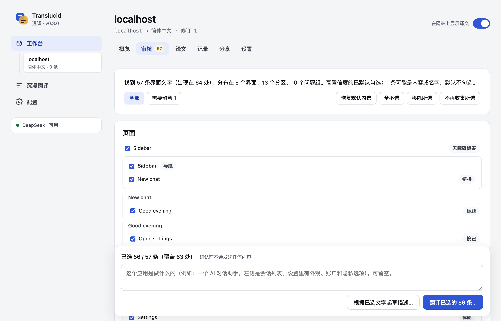
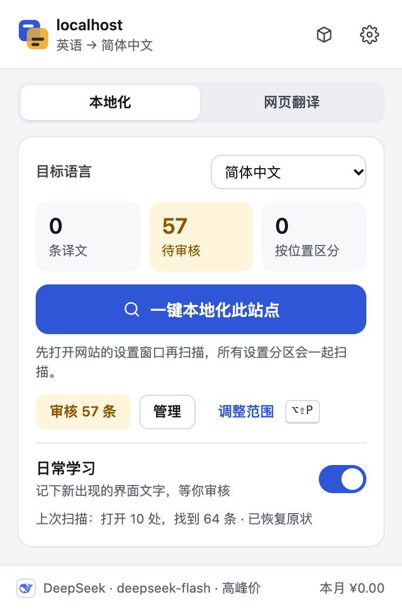
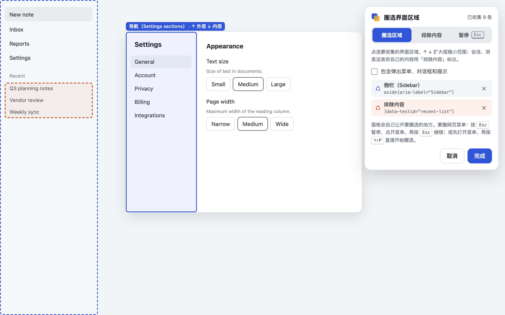
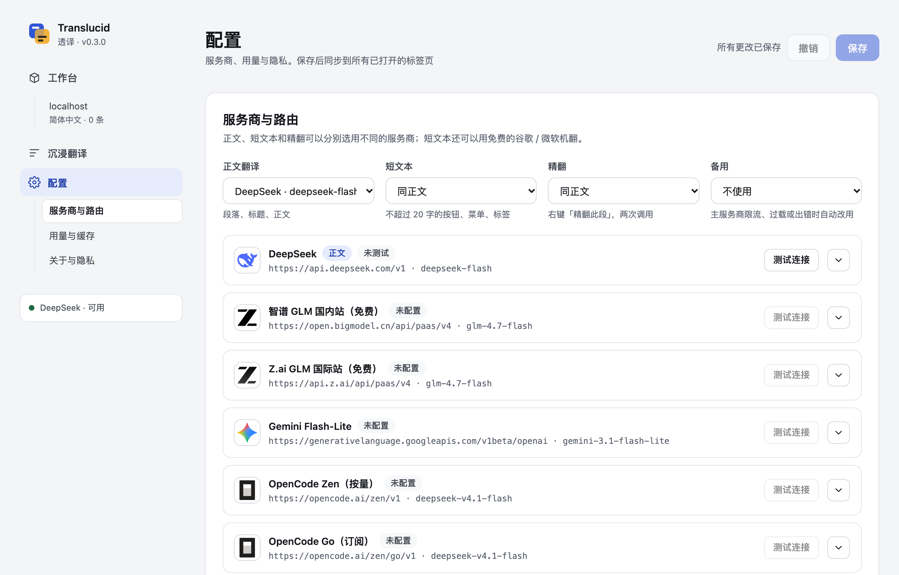

# Translucid · 透译

为没有你母语界面的网页应用生成**任意语言**的本地界面语言包；也能用大模型把网页翻译成**简体中文**（双语对照 / 只看译文）。Chrome / Edge 扩展（Manifest V3），自带 API Key，无服务器、无遥测。

An MV3 browser extension (Chrome / Edge) that builds local **site language packs**, showing a web app's interface in **any** language, and translates web pages into **Simplified Chinese** with an LLM. Bring your own API key; no server, no telemetry. [English summary below.](#english)



扩展分三块，从左侧导航或扩展图标进入：

| | 做什么 |
|---|---|
| **工作台** | 站点本地化（主打功能）：扫描网站界面、审核、生成和管理每个网站的语言包 |
| **沉浸翻译** | 阅读任意网页时的 AI 翻译：显示样式、场景专家、术语表、站点规则 |
| **配置** | 服务商与路由、用量与缓存、关于与隐私 |

---

## 站点本地化

为常用的网页应用（例如英文界面的 AI 助手、开发工具）一键生成完整的界面译文。扫描会自动打开菜单、设置分区和下拉列表，找出界面文字。翻译时按「界面 › 分区 › 问题 › 选项」的结构成组发给模型，所以同一个词在不同问题下能有不同的正确译法（例如文字大小里的 Medium 和栏宽里的 Medium）。结果保存在本机，之后打开网站直接显示目标语言界面，不再请求模型。

<p align="center"></p>

1. 打开要本地化的网站。想连设置一起翻译，就先打开它的设置窗口。
2. 点扩展图标，在「本地化」标签选择目标语言，点「一键本地化此站点」。第一次扫描会先说明扫描会做什么，请你同意。扫描只打开导航和菜单，不改任何设置，结束后恢复原状；按 Esc 可随时停止。
3. 在「工作台」查看找到的文字：
   - 按界面结构分组，高置信度的已勾选；
   - 可能是内容或名字的默认不勾选，并注明原因；
   - 会话列表、消息、账户名等个人内容不会被收集。
4. 确认一次，先看到将要发送的完整请求，再点「确认发送并生成」。
5. 已打开的页面立即显示译文。以后日常使用中出现的新界面文字会记下来等你审核（可关闭）。随时可以「显示原文」、按位置编辑译文、导出或导入语言包。

**手动调整范围**：需要精确控制时，用「调整范围」圈选要收集或排除的区域。

- 圈选面板会自动让开正在圈选的区域。
- 想圈选网页上展开的菜单，有两种做法：
  - 先打开菜单，再按 `Alt+Shift+P` 开始圈选（点扩展图标会让网页失去焦点、关掉菜单）；
  - 或者圈选中按 `Esc` 暂停，正常点开菜单，再按 `Esc` 继续。



能识别的界面结构包括：设置对话框的分区导航、带标签的选项组、「标题 + 说明 | 控件」式的设置行、原生下拉框、弹出菜单和下拉列表（含被渲染到页面别处的弹层）、侧栏导航和标签页。测试页面用真实的 Base UI 与 Radix 组件仿照常见生产力工具的结构。

候选文字只存在本机，30 天过期；导出前自动清洗个人信息，并让你预览。详见 [PRIVACY.md](PRIVACY.md) 和 [docs/DESIGN.md](docs/DESIGN.md)。

## 沉浸翻译

- **网页翻译**：双语对照或只看译文；优先翻译视口附近的内容，流式逐段显示；保留链接、加粗、代码等行内格式；本地缓存，刷新页面不重复请求。
- **场景专家**：通用、科技、新闻、学术、严谨（法律 / 医疗 / 金融）、社区、小说七套规则，按域名自动匹配，可编辑、导入导出。
- **术语表**：全局和按站点两级；只把本批命中的术语发给模型。
- **快捷键**：`Alt+A` 翻译 / 恢复，`Alt+S` 切换双语 / 只看译文；右键菜单可「精翻此段」。快捷键可以在浏览器的扩展快捷键设置里修改，弹出菜单会显示你当前的设置。

## 配置

- **多服务商**：DeepSeek、智谱 GLM、Z.ai、Gemini、Anthropic Claude、OpenCode Zen / Go、OpenRouter、NVIDIA NIM，以及任意 OpenAI 兼容接口。正文、短文本、精翻、备用可以分别选用不同的服务商。
- **稳健的调度**：按各服务商的限额设置并发和每分钟请求上限；遇到 429 / 503 自动退避；主服务商失败或过慢时转给备用服务商。
- **用量**：按服务商单价估算本月费用、请求数和前缀缓存命中率（以账单为准）。



## 安装

```bash
pnpm install
pnpm build          # 产物在 dist/chrome-mv3
```

1. 打开 `chrome://extensions`（Edge 为 `edge://extensions`），开启「开发者模式」，点「加载已解压的扩展程序」，选择 `dist/chrome-mv3`。
2. 点扩展图标右上角的齿轮打开「配置」，在「服务商与路由」里展开一个服务商，填入 API Key，点「测试连接」，然后保存。
3. 站点本地化见上文；阅读网页时按 `Alt+A` 翻译。

## 隐私

扩展只把文字发给你配置的服务商：

- 网页翻译时，发送要翻译的段落，以及页面标题、主题、命中的术语；
- 生成语言包时，只发送你确认过的界面文字。

API Key 保存在浏览器本地（未加密），不进入网页。没有遥测。完整的数据流（包括长文预处理、语言包请求带的应用名和域名）见 [PRIVACY.md](PRIVACY.md)。

## 重要声明

- **非官方接口**：可选的「谷歌翻译 / 微软翻译（免费·短文本）」用的是谷歌网页翻译组件和 Edge 内置翻译的**非公开接口**，不是官方 API，可能随时失效或被限流，使用受各自服务条款约束。这个选项默认关闭；开启后，短文本会发送给谷歌或微软。
- **商标**：设置页中各服务商的 Logo 和名称归其各自权利人所有，仅用于标识可接入的服务，不代表任何合作或认可。来源与使用依据见 [src/ui/logos/README.md](src/ui/logos/README.md)。
- **费用**：设置页里的价格只用于本地估算，以各服务商的账单为准。

## 开发

```bash
pnpm dev            # WXT 开发模式（自动打开加载了扩展的浏览器）
pnpm compile        # 类型检查
pnpm test           # 单元测试（Vitest + happy-dom）
pnpm e2e            # 端到端测试（Playwright + 本地 fixture 页面 + mock LLM；首次需 pnpm exec playwright install chromium）
pnpm harness        # http://localhost:5200：在本地页面上调试内容脚本（假后端）
pnpm build:debug    # 调试版：含页面调试接口和每次请求的指标日志
pnpm icons          # 从 src/ui/brand.ts 重新生成扩展图标
XT_API_KEY=… pnpm try --provider deepseek   # 用真实 API 试跑各场景的提示词
```

- e2e 的 fixture 包括用 Base UI / Radix 写的 claude-like、devin-like 页面，覆盖扫描、审核、圈选流程。
- 调试版的页面调试接口（`window.postMessage({ xtDebug: … })`）只存在于 `build:debug` 的产物中；调试完请重新 `pnpm build`。

```
entrypoints/        background / content（网页翻译）/ pack.content（语言包）/ scan.content（一键扫描）
                    sites（工作台）/ options（沉浸翻译、配置）/ popup
src/ui/             共用的界面规范（ui.css）、左侧导航（rail.ts）、图标与品牌
src/content/        段落提取、序列化 / 回填、渲染、调度
src/background/     会话、服务商、路由与限流、机翻、缓存、用量、语言包存储、生成、扫描授权
src/pack/           语言包格式、界面结构与语境、界面 / 内容分类、探索器、圈选、采集、应用器、隐私规则
src/prompt/         协议层、场景专家、术语表、语言包提示词
e2e/                Playwright 测试、fixture 页面、mock LLM
tests/              单元测试
docs/               设计说明、致谢、截图
```

欢迎提交 issue 和 PR。设计取舍见 [docs/DESIGN.md](docs/DESIGN.md)，借鉴的思路见 [docs/ACKNOWLEDGEMENTS.md](docs/ACKNOWLEDGEMENTS.md)。截图由测试数据生成，不含真实网站内容。

## 许可

[MIT](LICENSE)。打包进扩展的第三方依赖及其许可证见 [THIRD_PARTY_NOTICES.md](THIRD_PARTY_NOTICES.md)。

---

## English

**Translucid** has three parts, reachable from the side navigation or the toolbar popup:

- **Workbench (site localization, the headline feature)** localizes a web app's interface into **any** language.
  - **Scan.** One click explores the app's navigation sections, menus and dropdowns. It never changes settings and restores the page afterwards. It collects interface strings and leaves user content out.
  - **Group.** Strings are grouped by screen › section › question, so the same word can be translated correctly for each question it answers.
  - **Confirm.** You review what was found, see the exact request, and confirm once.
  - **Reuse.** The result is stored locally and applied in place on every later visit, without further model calls. New interface strings met during everyday use are queued for review.
  - **Edit and share.** Packs can be edited per context, exported (with automatic privacy scrubbing and a preview) and imported.
- **Immersive translation** translates web pages into Simplified Chinese with an LLM of your choice.
  - Side by side or in place.
  - Domain-specific prompt rules, glossaries and caching.
- **Config** covers the providers, routing, usage and privacy.
  - Providers: DeepSeek, Zhipu GLM, Z.ai, Gemini, Anthropic Claude, OpenCode, OpenRouter, NVIDIA NIM, or any OpenAI-compatible endpoint.
  - Robust rate limiting with provider fallback.

Other notes:

- **Install:** run `pnpm install && pnpm build`, then load `dist/chrome-mv3` as an unpacked extension. Open Config from the gear in the popup and add an API key under 服务商与路由.
- **Region picking** gives you fine control.
  - Open a page menu first, then press `Alt+Shift+P`. Clicking the toolbar icon would take focus from the page and close the menu.
  - `Esc` pauses and resumes picking.
  - The picker panel moves out of the way of what you are picking.
- **Privacy:** text goes only to the providers you configure. Keys stay in local browser storage (unencrypted). There is no telemetry. See [PRIVACY.md](PRIVACY.md).
- **Unofficial endpoints:** the optional free Google / Microsoft machine translation uses **unofficial** endpoints and is off by default.
- **Trademarks:** provider logos and names belong to their owners and only identify supported services.
- **Language and license:** the UI is in Simplified Chinese. License: [MIT](LICENSE).
